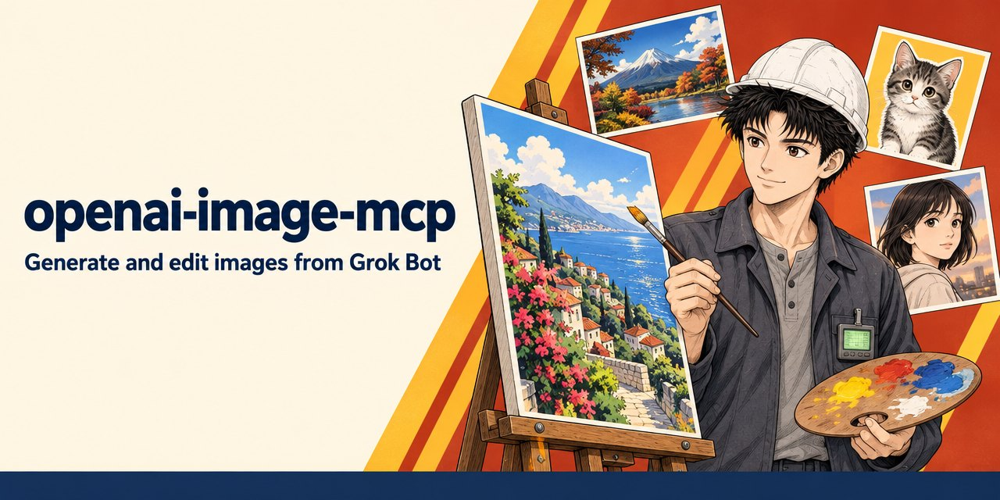

# openai-image-mcp

[](https://github.com/damao-bot-army/openai-image-mcp/actions/workflows/ci.yml)


[](LICENSE)



A single-user remote MCP server that runs on Cloudflare Workers and lets MCP clients such as Grok Bot generate and edit images with the OpenAI Images API. Images are stored in your own R2 bucket and returned as URLs with IDs, dimensions, format and size.

## Examples

All three images were generated by this service with its default model, `gpt-image-2.5-sunburst`, at quality `medium`. The service returned PNG files; the files in `docs/images/` are JPEG copies for display.

### Wide scene with `generate`


Tool `generate` with `size: "1536x864"`, `quality: "medium"`, `output_format: "png"`. Prompt:

> Wide panoramic anime illustration in the style of 1990s Masakazu Katsura manga color art: a rainy night market street in Taipei, glowing red and amber paper lanterns, steaming food stalls, wet pavement reflecting neon signs, a young woman with a clear umbrella and a small orange cat on her shoulder walking toward the viewer, clean line art, warm cel shading, saturated color blocks, golden-yellow accents. No readable text anywhere.

### Transparent sticker with `generate`


Tool `generate` with `size: "1024x1024"`, `quality: "medium"`, `background: "transparent"`, `output_format: "png"`. The service returned a PNG with a transparent background; the JPEG shown here is that PNG scaled to 800x800 and placed on a light blue-grey background for display. Prompt:

> Die-cut vinyl sticker design: a cheerful round-faced orange tabby cat wearing a white hard hat and holding a tiny wrench, thick white sticker border, clean bold outlines, flat saturated colors with simple cel shading, centered, no shadow, no text. Fully transparent background outside the white sticker border.

### Character redraw with `edit`


Tool `edit` with `images` set to the ID of one input image, `size: "1024x1024"`, `quality: "medium"`, `output_format: "png"`. The input was a 1024x1024 JPEG portrait uploaded with `create_upload`: a young man with black hair wearing a white hard hat and holding a rolled blueprint, on a flat red background. The input image is not part of this repository. The output shown here is scaled to an 896x896 JPEG. Prompt:

> Redraw this exact character (same face, black hair, white hard hat, grey work jacket, rolled blueprint) in a rainy night city scene: he stands under a street lamp, rain streaks, wet reflections, a glowing city skyline behind him, blueprint held under his arm out of the rain. Keep the same 1990s manga line-art style, fine pen linework and soft shading, but with a deep blue and gold night palette instead of the flat red background.

## Status

- **Who it is for:** people who run Grok Bot or another MCP client and want their own image generation service, deployed to their own Cloudflare account and billed to their own OpenAI account. It has one owner: a single password (`AUTH_PASSWORD`) authorizes clients, and there are no user accounts.
- **Maturity:** early. Version 0.2.0, written and used by its author. Tool names, parameters and result fields may still change.
- **Requirements:**
  - A Cloudflare account with Workers, Durable Objects, R2 and KV. The Images binding is used for optional previews.
  - An OpenAI API key for an account that can use the image model (default `gpt-image-2.5-sunburst`).
  - Node.js 22.18 or later (24.11 or later on Node 24) for installing, testing and deploying.
  - Secrets: `OPENAI_API_KEY` and `AUTH_PASSWORD` (required), `UPLOAD_SIGNING_KEY` (optional).
- **Releases:** none yet. Deploy from source on `main`.

Bug reports and fixes are welcome; see [CONTRIBUTING.md](CONTRIBUTING.md). Report security issues privately as described in [SECURITY.md](SECURITY.md).

## Tools

| Tool | Purpose |
| --- | --- |
| `generate` | Create 1–10 images from a prompt. |
| `edit` | Edit or combine 1–16 input images, with an optional `mask` or `markup`. |
| `get_job` | Wait for and fetch the result of a job that is still running. |
| `create_upload` | Get one-time signed URLs to upload local image files for `edit`. |

The tools expose the model's full parameter set: any size up to 3840x2160, quality up to `max`, up to 10 images, transparency, masks, markup and partial images. Long jobs run asynchronously in a Durable Object, so clients with a 60-second timeout still get their results. Local files can be uploaded with one `curl` command.

### `generate` and `edit` parameters

Only parameters you set are sent to OpenAI; omitted ones use OpenAI's defaults. Validation follows the constraints documented in `openai@7.47.0`.

| Parameter | Tools | Values |
| --- | --- | --- |
| `prompt` | both | Required. About 8,192 tokens at most (see [Prompt length](#prompt-length)): roughly 8,000 Chinese/Japanese/Korean characters or 32,000 English characters. Never more than 32000 characters. |
| `images` | edit | Required, 1–16 references (see below). PNG, JPEG or WebP, each under 50 MiB, at most 64 MiB in total per edit. |
| `mask` | edit | Reference to a PNG under 4 MiB, same size as the first image; fully transparent pixels mark the area to edit. |
| `markup` | edit | Reference to a transparent PNG, same size as the first image, drawn over it to guide the edit. Not combinable with `mask`. |
| `input_fidelity` | edit | `high` or `low`. Model-dependent; sent only when set. On 2026-11-04, a call with the default model `gpt-image-2.5-sunburst` returned HTTP 400 (`invalid_input_fidelity_model`), so that model does not support it; set it only for models that do. |
| `size` | both | `auto` or `WIDTHxHEIGHT`: both edges multiples of 16, aspect ratio between 1:3 and 3:1, each edge ≤ 3840, at most 8,294,400 pixels (3840x2160). Sizes above 2560x1440 are experimental at OpenAI. |
| `quality` | both | `low`, `medium`, `high`, `xhigh`, `max`, `auto`; legacy `standard` (both) and `hd` (generate). `xhigh`/`max` are for the gpt-image-2.5 models. |
| `n` | both | 1–10. |
| `background` | both | `transparent`, `opaque`, `auto`. Transparent requires `png` or `webp`. |
| `output_format` | both | `png`, `jpeg`, `webp`. |
| `output_compression` | both | 0–100, with `jpeg` or `webp` only. |
| `moderation` | generate | `low` or `auto`. |
| `partial_images` | both | 0–3. Uses OpenAI streaming; partial images are stored and listed while the job runs and in the final result. |
| `safety_identifier` | both | Stable end-user identifier for OpenAI abuse monitoring. |
| `preview` | both | `true` to also return 512px JPEG previews as MCP image content. Default `false`. |
| `wait_seconds` | both | 0–45, default 45. How long the call waits before returning a `job_id`. |

The model is always `IMAGE_MODEL`. `stream` is used internally for `partial_images`; the deprecated `response_format`, `style` and `user` parameters are not exposed.

### Prompt length

OpenAI documents a 32000-character prompt limit, but in practice the image endpoints silently drop prompts longer than about **8,192 tokens**: the request still succeeds, `usage.input_tokens` is about 8, and the image ignores the prompt. Measured: 8,000 Chinese characters = 7,490 tokens and 8,500 = 7,958 (both used); 9,000 or more were dropped; 32,000 English characters = about 6,700 tokens.

The server therefore estimates the token count before sending and rejects prompts estimated above 8,100 tokens with an error that gives the estimate. The estimate needs no tokenizer and errs on the high side: one token per CJK character (Han, kana, Hangul, CJK punctuation, full-width forms; measured 0.94) and one token per 4 UTF-8 bytes of other text (measured about 4.8 English characters per token), rounded up per run. In practice: Chinese up to about 8,000 characters; English up to the 32000-character limit. English prompts near 32000 characters with many non-ASCII punctuation marks (curly quotes, dashes) can exceed the estimate and need to be shortened slightly.

As a fallback, if OpenAI reports 16 or fewer text input tokens (`usage.input_tokens_details.text_tokens`, else `usage.input_tokens`) for a prompt of 200 or more characters, the result gets a `warning` saying the prompt was most likely ignored. The images are still returned.

### Image references

`images`, `mask` and `markup` take either a 22-character image ID from `generate`, `edit` or `create_upload`, or a public `https` URL. IDs (and this server's own `/img/<id>` URLs) are read directly from R2. Other URLs are downloaded server-side with a 30-second timeout and at most three redirects; the format is detected from the file contents. HTTP, embedded credentials, localhost and IP literals are rejected, and `global_fetch_strictly_public` blocks private destinations. A local path, `file://` URL or data URL is rejected with an error that explains the upload flow.

### Results

`generate`, `edit` and `get_job` return the same structure, as JSON text and as `structuredContent` (each tool declares an `outputSchema`):

```json
{
  "job_id": "job_Q2xGq0m8vS1ZbYw7nTt4pA",
  "status": "succeeded",
  "images": [
    {
      "id": "aB0123456789cDeF012345",
      "url": "https://<your-worker-host>/img/aB0123456789cDeF012345",
      "width": 1536,
      "height": 864,
      "format": "png",
      "bytes": 2483021
    }
  ],
  "model": "gpt-image-2.5-sunburst",
  "usage": { "input_tokens": 52, "output_tokens": 4160, "total_tokens": 4212 },
  "params": { "size": "1536x864", "quality": "high" },
  "resolved": { "size": "1536x864", "quality": "high", "background": "opaque", "output_format": "png" },
  "next": "To keep editing, call edit with images: [\"aB0123456789cDeF012345\"] (use any returned id). To save a file: curl -o aB0123456789cDeF012345.png https://<your-worker-host>/img/aB0123456789cDeF012345"
}
```

- `width`, `height`, `format` and `bytes` are read from the stored file. `revised_prompt` is included per image when OpenAI returns one.
- `warning` (a string) is present when something needs attention: the prompt was most likely ignored by OpenAI (see [Prompt length](#prompt-length)), or a requested preview could not be produced.
- `params` are the parameters sent to OpenAI; `resolved` is what OpenAI reports it used (for example, the size picked for `auto`).
- `partial_images` (with `index`) appears when `partial_images` was requested.
- Full-size base64 is never returned. With `preview: true`, a 512px JPEG preview per image follows as MCP `image` content (quality 75, no upscaling); without the Images binding, `warning` says so instead.
- Invalid input and failed jobs are MCP tool errors (`isError: true`). A failed job reports `status: "failed"` and the OpenAI error verbatim, including HTTP status, code and parameter.

### Asynchronous jobs

Every `generate` or `edit` call creates a job (`job_…`) in its own `ImageJob` Durable Object. The work runs in the object's alarm handler, independent of the MCP request:

1. The call waits up to `wait_seconds` (default 45). If the request carries a `progressToken`, it sends an MCP progress notification right away and then about every 10 seconds (including partial image URLs when available).
2. If the job finishes in time, the full result is returned.
3. Otherwise the call returns `{"job_id": "...", "status": "running", "next": "..."}`. Call `get_job` with that `job_id`; it waits up to 45 seconds per call with the same progress notifications and returns the result or the error.

Jobs keep running if the client disconnects, and their results remain available from `get_job` for 30 days. If the Durable Object restarts mid-job, the platform retries the alarm once more; a job that still has no result is reported as failed. The OpenAI request times out after 10 minutes. Use `wait_seconds: 0` to start several jobs in parallel and collect them with `get_job`.

### Editing local images

The server cannot read files on the client machine, and MCP tool arguments are not a practical way to send image bytes. Use `create_upload` instead (the caller needs a shell with `curl`):

1. Call `create_upload` (optionally `{"count": 3}` for several files). It returns, per file, an `id`, an `upload_url` and a ready-to-run command:
   ```sh
   curl -sS --fail-with-body -X PUT --data-binary @/path/to/image.png 'https://<your-worker-host>/upload/<id>?exp=…&sig=…'
   ```
2. Replace `/path/to/image.png` with the file and run it. The response is JSON: `{"id", "url", "width", "height", "format", "content_type", "bytes", "next"}`.
3. Call `edit` with `images: ["<id>"]`. Masks and markup images are uploaded the same way and passed as `mask` / `markup`.
4. Every result has its own ID, so later edits need no further uploads. Download results with `curl -o out.png <url>`.

Upload URLs need no OAuth token: each is signed (HMAC-SHA256 over the ID and expiry), valid for 15 minutes and usable once. The Worker accepts PNG, JPEG and WebP up to 50 MiB, detected from the file contents (the `Content-Type` header is ignored), and stores the file as `img/<id>.<ext>` with `source=upload`. Errors: `403` bad signature, `410` expired, `409` already used, `413` too large, `415` not an image, `400` empty body.

The signing key is derived with HKDF from the optional secret `UPLOAD_SIGNING_KEY`, or from `OPENAI_API_KEY` when that secret is not set, so uploads work without extra setup. Changing the secret in use invalidates outstanding upload URLs.

## Deployment

The steps below deploy the Worker to your Cloudflare account. `<your-worker-host>` stands for the host the Worker is reachable at: either `openai-image-mcp.<your-subdomain>.workers.dev`, printed by Wrangler on deploy, or a custom domain you configure.

1. Install the dependencies and log in to Cloudflare:

   ```sh
   git clone https://github.com/damao-bot-army/openai-image-mcp.git
   cd openai-image-mcp
   npm ci
   npx wrangler login
   ```

2. Create the R2 bucket and the OAuth KV namespace. The second command prints the namespace ID.

   ```sh
   npx wrangler r2 bucket create openai-image-mcp
   npx wrangler kv namespace create OAUTH_KV
   ```

3. Create your deployment config. The committed `wrangler.jsonc` contains only an all-zero **placeholder** KV ID. Copy it to the git-ignored `wrangler.local.jsonc` and put your real values there:

   ```sh
   cp wrangler.jsonc wrangler.local.jsonc
   ```

   In `wrangler.local.jsonc`, replace the placeholder KV ID, adjust the R2 bucket name if needed, and optionally add a custom domain (`"routes": [{ "pattern": "<your-worker-host>", "custom_domain": true }]`). If you already have a `wrangler.local.jsonc` from an earlier version, add the `IMAGE_JOBS` Durable Object binding and the `v2` migration from `wrangler.jsonc` to it; `wrangler deploy` applies the migration (a new SQLite class `ImageJob`).

4. Set the secrets:

   ```sh
   npx wrangler secret put OPENAI_API_KEY -c wrangler.local.jsonc   # required
   npx wrangler secret put AUTH_PASSWORD -c wrangler.local.jsonc    # required
   npx wrangler secret put UPLOAD_SIGNING_KEY -c wrangler.local.jsonc  # optional, see "Editing local images"
   ```

   Use a restricted OpenAI project key and a long, random authorization password. Never put real values in `wrangler.jsonc` or other committed files.

   Optional variables: `IMAGE_MODEL` (default `gpt-image-2.5-sunburst`) and `OPENAI_BASE_URL` (default `https://api.openai.com/v1`, for example to route through Cloudflare AI Gateway).

5. Check and deploy:

   ```sh
   npm run typecheck
   npm test
   npx wrangler deploy --dry-run -c wrangler.local.jsonc --outdir dist
   npx wrangler deploy -c wrangler.local.jsonc
   ```

   `npm run deploy` runs the same deploy command.

6. Add the R2 lifecycle rules described in [Stored data and deletion](#stored-data-and-deletion).

To update a deployment, pull the latest `main`, run `npm ci`, and repeat step 5.

## Connecting a client

In Grok Bot or another MCP client that supports remote servers over Streamable HTTP with OAuth, add the server URL with the `/mcp` path:

```text
https://<your-worker-host>/mcp
```

No client ID or secret needs to be configured: the server supports OAuth dynamic client registration and Client ID Metadata Documents. When the client starts the OAuth flow, a consent page opens in the browser. Check the client name, enter `AUTH_PASSWORD`, and click **Allow**; if you mistype the password, **Try again** reopens the same request. The client then lists the four tools above.

For local testing with MCP Inspector, see [Local development and MCP Inspector](#local-development-and-mcp-inspector).

## Permissions and privacy

The Worker serves these paths on one origin:

| Path | Access |
| --- | --- |
| `/mcp` | MCP endpoint. Requires an OAuth bearer token with the `images` scope; requests without a valid token receive `401`. |
| `/authorize` | Consent page. Approving requires `AUTH_PASSWORD`. |
| `/oauth/register`, `/oauth/token`, `/.well-known/oauth-authorization-server`, `/.well-known/oauth-protected-resource` | OAuth client registration, token exchange and discovery. |
| `/upload/<id>` | `PUT` only, with a signed one-time URL from `create_upload`. |
| `/img/<id>` | `GET` and `HEAD`, public, no token. |

- An approved client can call all four tools, which spend OpenAI credit on your key. Every approved client acts as the single owner; there is no per-client separation of images or jobs.
- OAuth records live in KV, separate from the images. Changing `AUTH_PASSWORD` does not revoke issued tokens; to revoke all grants, use a fresh OAuth KV namespace and redeploy. Consider a Cloudflare rate-limiting rule for `/authorize`.
- Prompts, parameters, input images and `safety_identifier` are sent to OpenAI (or to `OPENAI_BASE_URL` if set). Image URLs passed as references are downloaded by the Worker, not by OpenAI.
- Image URLs are public: anyone who has a `/img/<id>` URL can download that image. See below.

## Stored data and deletion

| Where | What | Kept |
| --- | --- | --- |
| R2 `img/` | Generated, edited, partial and uploaded images | Until deleted (lifecycle rules below) |
| R2 `meta/` | One JSON record per generated, edited or uploaded image, including the full prompt | Until deleted (lifecycle rules below) |
| `ImageJob` Durable Objects | Job request (prompt, parameters, input references) and result | Deleted automatically 30 days after the job finishes |
| `ImageMcp` Durable Objects | MCP session state | Managed by the `agents` package |
| `OAUTH_KV` | OAuth clients, grants and tokens | Managed by `@cloudflare/workers-oauth-provider` |

Images received as URL references are not stored; only the reference is recorded in `meta/`.

### R2 keys

| Key | Content |
| --- | --- |
| `img/<id>.<png\|jpeg\|webp>` | The image, with its `Content-Type`. Custom metadata: `source` (`generate`, `edit` or `upload`), `job-id`, `model`, `size` (actual `WIDTHxHEIGHT`), `created-at`, `prompt-preview` (first 200 characters). |
| `meta/<id>.json` | Full record: complete prompt, parameters sent, input references (edit), `revised_prompt`, `usage`, `model`, `resolved`, `warning` (or `null`), actual width/height/format/bytes, `job_id`, `created_at`. Uploads get a short record with `source: "upload"`. |

R2 custom metadata is limited to 8 KiB per object, so the full prompt (up to 32000 characters; an 8,000-character Chinese prompt alone is about 24 KB of UTF-8) is kept in `meta/<id>.json` and only small fields go into custom metadata. Partial images are stored under `img/` but get no `meta/` record.

### Public image URLs

`GET /img/<id>` (and `HEAD`) is public and serves only the image bytes, never the `meta/` record. IDs are cryptographically random 22-character base62 strings (about 131 bits); the URL is the access credential. Anyone you share a URL with, or any place a client posts it, can fetch the image until it is deleted. Responses may be cached for one hour, including after deletion. Unknown or expired IDs return `404`.

### Deleting data

To delete images and their records after 30 days, add **two** lifecycle rules in the Cloudflare dashboard (**R2 → your bucket → Settings → Object lifecycle rules**), or with Wrangler:

```sh
npx wrangler r2 bucket lifecycle add openai-image-mcp expire-images-30-days img/ --expire-days 30
npx wrangler r2 bucket lifecycle add openai-image-mcp expire-meta-30-days meta/ --expire-days 30
```

Rules apply to existing objects by age; lifecycle processing is asynchronous. Job records in the `ImageJob` Durable Objects delete themselves after 30 days.

To delete one image right away, delete both of its objects (use the image's actual extension):

```sh
npx wrangler r2 object delete openai-image-mcp/img/<id>.png --remote
npx wrangler r2 object delete openai-image-mcp/meta/<id>.json --remote
```

## Development

### Stack and defaults

- TypeScript, `agents` `McpAgent`, MCP Streamable HTTP at `/mcp`.
- `@cloudflare/workers-oauth-provider`: OAuth 2.1, browser-bound consent, PKCE, dynamic client registration, and Client ID Metadata Documents. The owner signs in with `AUTH_PASSWORD`; no external identity provider is required.
- R2 (`IMAGES_BUCKET`), Images (`IMAGES`, optional previews), SQLite Durable Objects (`IMAGE_MCP` for MCP sessions, `IMAGE_JOBS` for image jobs), and OAuth KV (`OAUTH_KV`).
- Default `IMAGE_MODEL`: **`gpt-image-2.5-sunburst`**, confirmed in `openai@7.47.0`'s `resources/images.d.ts` (which also lists `gpt-image-2.5-flare`). Set `IMAGE_MODEL` in the Wrangler config to change it. The OpenAI package is a development-only reference for parameter names and limits; the Worker calls the API with `fetch`.
- The current `agents` package also imports the optional peer `@modelcontextprotocol/server`. It is installed for bundling; this `McpAgent` uses the v1 `@modelcontextprotocol/sdk` server API.
- Node.js 22.18 or later (24.11 or later on Node 24), from the `engines` fields of the dependencies (`wrangler`, `vitest`, and Babel packages pulled in by `agents`). CI runs on Node 22.

### Local development and MCP Inspector

Local bindings use Wrangler's local emulators; do not enable remote bindings or `--remote` for local tests.

For a manual session, create a git-ignored `.dev.vars`:

```dotenv
OPENAI_API_KEY=YOUR_RESTRICTED_OPENAI_KEY
AUTH_PASSWORD=YOUR_LOCAL_AUTHORIZATION_PASSWORD
```

```sh
npm run dev -- --local
# In a second terminal:
npx @modelcontextprotocol/inspector
```

Choose **Streamable HTTP**, enter `http://localhost:8787/mcp`, and use the Inspector's OAuth flow. Calling an image tool with a real key makes a real OpenAI request.

For an automated local check without real secrets or OpenAI calls:

```sh
npm run smoke
```

This starts `wrangler dev --local` with an ephemeral password, isolated temporary storage and a local mock of the OpenAI Images API (`OPENAI_BASE_URL`; the smoke run drops `global_fetch_strictly_public` so the Worker can reach the mock on localhost). It covers OAuth (dynamic registration, wrong password and retry, deny, consent + PKCE, token), `tools/list`, `generate` (an 8,000-character Chinese prompt is accepted, 9,000 is rejected), `create_upload` + `PUT` + reuse rejection, `edit` with an uploaded ID, the local-path error, a slow job via `get_job` with progress notifications, a job that finishes after its client disconnected, and OpenAI error passthrough — all through the real MCP transport, Durable Objects, alarms and local R2. Port 8787 must be free (`SMOKE_PORT=8790 npm run smoke` selects another).

### Verification

```sh
npm ci && npm run typecheck && npm test
npx wrangler deploy --dry-run --outdir dist
npm run smoke
```

The dry run uses the committed `wrangler.jsonc` and needs no Cloudflare login; CI runs the same command. Add `-c wrangler.local.jsonc` to check your own deployment config.

Vitest mocks OpenAI `fetch`, R2, Images and the job Durable Object storage. It covers size and parameter validation, parameter passthrough for both endpoints, streamed response decoding, `meta/` records, long prompts, the prompt token estimate and limit, the ignored-prompt warning, partial images, uploads (valid, expired, tampered, reused, wrong format, oversize), edits from IDs, uploads and URLs, input size limits, async jobs (fast, slow, failed, disconnected, interrupted) with progress notifications, MCP output schemas via an in-memory MCP client, the public image endpoint, and OAuth rejection.

## License

[MIT](LICENSE)
